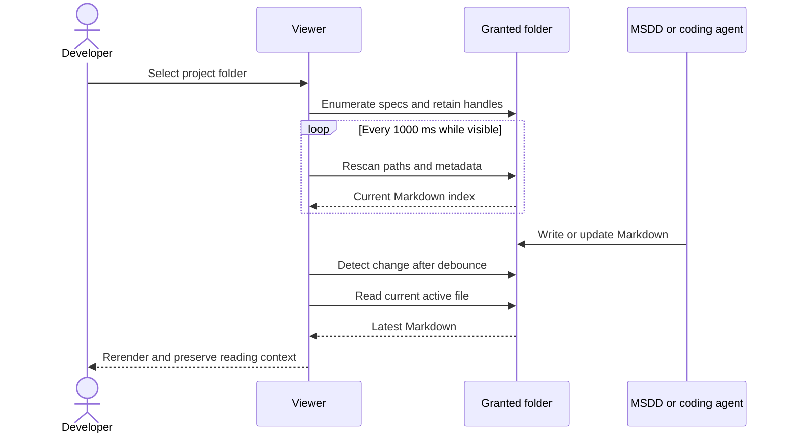

# Live spec viewer refresh

## Summary

Add live refresh to the local browser viewer launched by `msdd serve`. After a user grants File System Access to a project folder, the viewer must detect Markdown changes under `specs/` and update the open reader without a browser refresh. The first implementation uses one-second browser polling and a 250 ms debounce window. It does not add server-side file watching, SSE, or WebSockets.

## Problem

The viewer currently stores one-time `File` snapshots after folder selection. When `msdd spec` or `msdd build` generates or rewrites `explore.md`, `spec.md`, or `task.md`, the open reader continues to show stale content until the user refreshes the page or selects the folder again. This interrupts the specification workflow and can make the displayed document differ from the current source of truth.

## Goals and Non-Goals

### Goals

- Detect changes to Markdown files below the selected direct `specs/` directory.
- Refresh changed documents without a browser reload or folder reselection.
- Detect added, deleted, and renamed Markdown files and keep the sidebar accurate.
- Preserve the active route, selected artifact, reader scroll position, and current heading when possible.
- Coalesce rapid multi-file generation into one refresh after a 250 ms debounce period.
- Pause background checks while the page is hidden and rescan immediately when it becomes visible.
- Keep project contents in the browser and preserve the existing local privacy model.
- Provide a manual reload action for directory-upload snapshot mode.

### Non-goals

- Add server-side project filesystem access.
- Add SSE, WebSockets, or a project-path API to `src/server.js`.
- Make directory-upload fallback selections live when the browser provides no persistent handle.
- Edit, create, rename, delete, or persist project files.
- Add a settings panel or configurable polling UI.
- Replace the existing Markdown, sanitization, Mermaid, routing, or history behavior.

## Users and Scenarios

### Actors

- Developer: runs `msdd serve`, selects a project folder, and reads specifications.
- MSDD or coding agent: creates or updates files under `specs/`.
- Viewer: observes the granted folder and renders the current document.

### Scenarios

1. Developer opens `spec.md`; an agent updates it; the viewer detects the change within the configured polling target and rerenders the document without navigation.
2. `msdd spec` creates `spec.md` and `task.md` in quick succession; the viewer coalesces the changes and refreshes once after the debounce window.
3. An agent adds or removes a Markdown artifact; the viewer updates the sidebar while retaining the current file if it still exists.
4. The developer switches to another browser tab; refresh checks pause. On return, the viewer performs an immediate rescan.
5. The developer uses directory upload in a browser without File System Access; the viewer labels the content as a snapshot and provides manual folder reload instead of claiming live updates.
6. Permission is revoked or a file becomes unreadable; the viewer keeps the last valid document when possible and shows an actionable recovery message.

## Requirements

- REQ-001: The File System Access selection path must retain the selected `FileSystemDirectoryHandle` and each Markdown file's `FileSystemFileHandle` in memory. Priority: high.
- REQ-002: While a live folder is active and the document is visible, the viewer must rescan the direct `specs/` tree every 1000 ms. Priority: high.
- REQ-003: A rescan must compare Markdown relative paths and file metadata, including `lastModified` and size when available, and identify changed, added, deleted, or renamed files. Priority: high.
- REQ-004: The viewer must debounce/coalesce detected changes for 250 ms before rebuilding the tree or rerendering the active document. Priority: high.
- REQ-005: The viewer must refetch current contents through the retained file handle and must not use the original `File` snapshot after a change is detected. Priority: high.
- REQ-006: If the active artifact still exists, refresh must preserve its route and selected state. The viewer should restore reader scroll offset and the previously active heading when matching content exists. Priority: high.
- REQ-007: If the active artifact is deleted or renamed, the viewer must select `spec.md` when available, otherwise the first sorted Markdown file, and announce the recovery state. Priority: medium.
- REQ-008: The refresh controller must pause when `document.hidden` is true, stop when the folder is replaced, and perform an immediate rescan on `visibilitychange` to visible. Priority: high.
- REQ-009: The viewer must expose a concise non-blocking update status, including a successful refresh state and recoverable read/permission failure state. Priority: medium.
- REQ-010: Directory-upload selections must remain snapshot mode and must expose a manual “Reload folder” action. Priority: high.
- REQ-011: The implementation must not add project-content routes, server-side watchers, SSE, WebSockets, or network access to selected project files. Priority: high.
- REQ-012: Existing folder selection, recent-folder permission checks, Markdown sanitization, Mermaid rendering, route handling, and reader layout must continue to work. Priority: high.

## User/System Flows

1. Developer selects a project through File System Access.
2. Viewer locates the direct `specs/` directory, retains its directory handle, enumerates Markdown files, retains file handles, and renders the selected artifact.
3. Viewer starts a one-second refresh controller.
4. Refresh controller rescans `specs/` and compares paths and metadata with the current in-memory index.
5. If no difference exists, the reader remains unchanged.
6. If a difference exists, the controller waits 250 ms for related writes, rescans once more, updates the tree, and refetches the active file if changed.
7. Viewer rerenders the document, restores route and reading context, and updates the status message.
8. If the active file is gone, viewer chooses the standard fallback file and announces the change.
9. If permission or reading fails, viewer retains the last valid content when possible and shows a recovery action.
10. When the page becomes hidden, checks pause. When it becomes visible, the viewer rescans immediately and resumes the interval.

## Technical Design

### Solution Description

Extend the existing browser viewer with handle-backed file descriptors and a lifecycle-managed refresh controller. The browser, not the Node server, reads the selected project. A one-second rescan detects metadata changes; a 250 ms debounce groups multi-file writes; the active document is reread from its `FileSystemFileHandle` and rendered through the existing Markdown/sanitization/Mermaid pipeline.



### Current State

`src/viewer/tree.js` creates descriptors around one-time `File` objects and exposes `readText: () => value.text()`. `src/viewer/app.js` loads those descriptors once, renders the selected artifact, and has no refresh controller. `src/server.js` serves only static viewer assets and cannot see the selected project.

### Proposed Design

Update the directory-based descriptor shape to retain a file handle, current metadata, and a `readText` function that calls `handle.getFile()` when content is needed. Add pure comparison/rescan helpers and a refresh lifecycle in `src/viewer/app.js` or a focused viewer module. The lifecycle owns interval start/stop, visibility events, debounce scheduling, active-file recovery, and status updates. Keep upload descriptors separate and mark them as snapshot mode.

### Architecture / Components

- `src/viewer/tree.js`: enumerate directory handles, retain file handles, return metadata-backed descriptors, and provide deterministic tree/index comparison.
- `src/viewer/app.js`: start and stop refresh lifecycle, coordinate rescans with navigation, preserve reader state, handle active-file fallback, and expose status/reload actions.
- Optional `src/viewer/refresh.js`: house testable polling, debounce, metadata comparison, and visibility lifecycle logic if separation improves maintainability.
- `src/viewer/index.html`: provide live/snapshot status and manual reload affordance without adding settings.
- `src/viewer/styles.css`: style status/reload affordance using the existing design system.
- `src/server.js`: unchanged for project access; continue serving only static viewer and renderer assets.

### Data Model / API Changes

No server API or persistent project-data model changes.

In-memory live descriptor:

```text
{
  relativePath,
  lastModified,
  size,
  handle,
  readText: () => Promise<string>,
  mode: "live"
}
```

Upload descriptors retain their current one-time `File` behavior and use `mode: "snapshot"`. IndexedDB continues to store only directory handles and display names.

### Technical Decisions

- Use a one-second polling interval as the portable baseline.
- Use a 250 ms debounce/coalescing window for bursts.
- Read changed content through `FileSystemFileHandle.getFile()`.
- Pause while hidden and rescan immediately on visibility return.
- Refresh all Markdown files under the direct `specs/` directory.
- Preserve current route, active artifact, scroll offset, and matching heading where possible.
- Use standard fallback selection when the active file disappears.
- Keep upload fallback snapshot-based with manual reload.
- Do not add server-side watchers or event transports.

### Trade-offs

- Polling is portable and preserves the current privacy model, but browser scheduling bounds the freshness guarantee.
- Retaining handles adds descriptor and permission lifecycle complexity, but is required to observe current files instead of stale snapshots.
- Targeted rerendering requires state preservation logic, but avoids disrupting the reader on every generated file change.
- Upload fallback cannot be live without a persistent browser handle; a manual reload is explicit and predictable.

### Failure Handling

- If a directory rescan fails temporarily, retain the last valid tree and retry on the next interval.
- If permission is lost, pause live checks and show a recovery action that requests permission again.
- If a file read fails, retain the previous rendered document when possible and show a non-blocking error.
- If the active file disappears, select `spec.md`, then the first sorted Markdown file, or show an empty-state message if none remain.
- If a refresh races with navigation, discard stale asynchronous results using the existing navigation-version protection.
- If a burst continues beyond the debounce window, perform another comparison after the next interval.

### Testing Strategy

- Add pure unit tests for live descriptor metadata, path/index comparison, added/deleted/renamed detection, and default fallback selection.
- Add refresh-controller tests with fake timers for one-second polling, 250 ms debounce, pause/resume, visibility-triggered rescan, and lifecycle cleanup.
- Add viewer tests that verify current file content is obtained from `getFile()` rather than the original `File` snapshot.
- Add tests for preserving route and reader state, active-file deletion, permission failure, transient read failure, and upload snapshot/manual reload behavior.
- Run the existing full test suite and package check; manually verify edits generated by `msdd spec` and `msdd build` appear without a browser refresh.

## Decisions and Constraints

### Confirmed Decisions

- Live refresh applies to the local viewer launched by `msdd serve`.
- Use browser-side polling every 1000 ms with a 250 ms debounce window.
- Retain File System Access handles and reread current file contents.
- Pause while hidden and rescan immediately when visible.
- Preserve reader context where possible.
- Keep directory-upload mode snapshot-based with manual reload.
- Do not add server-side watchers, SSE, or WebSockets.

### Assumptions

- A one-second freshness target satisfies the user's “immediately” requirement.
- The browser grants read permission for the selected directory for the active page/session.
- `lastModified` and file size are sufficient change hints; content is reread whenever metadata changes.

### Constraints

- Project contents remain browser-local.
- The static Node server must not accept arbitrary project paths or project-content requests.
- Existing route, rendering, security, history, and design behavior must remain compatible.
- No settings UI is required.

### Open Questions

- None for the agreed first implementation. An optional `FileSystemObserver` enhancement may be evaluated later without changing the polling contract.

## Edge Cases and Failure Handling

- **Rapid generated writes:** Coalesce changes for 250 ms, then rescan and render the settled state.
- **Added Markdown file:** Add it to the correct tree location and retain the current reader.
- **Deleted active file:** Select `spec.md`, then the first sorted Markdown file; show a status message.
- **Renamed active file:** Treat the old path as deleted and the new path as added; select the standard fallback unless the implementation can safely match the file identity.
- **No changes:** Do not rerender or move scroll position.
- **Hidden page:** Stop interval checks; perform one immediate rescan on return.
- **Permission revoked:** Stop or suspend checks and request permission again through an explicit user action.
- **Transient read error:** Keep the last valid content and retry automatically.
- **Upload snapshot:** Do not poll stale `File` objects; manual reload replaces the snapshot.
- **Refresh/navigation race:** Ignore obsolete asynchronous reads and keep the newest navigation result.

## Acceptance Criteria

- AC-001: After selecting a project through File System Access, editing the active Markdown file appears in the viewer within approximately one second plus the 250 ms debounce window, without browser refresh.
- AC-002: The active file is reread from its current `FileSystemFileHandle`; the viewer does not continue rendering the original `File` snapshot.
- AC-003: Added, deleted, and renamed Markdown files update the sidebar after the next coalesced refresh.
- AC-004: Rapid updates to multiple files produce one coalesced refresh after the debounce window and display the settled readable content.
- AC-005: Refresh preserves the active route and file, and preserves scroll position/current heading when the content still contains the target.
- AC-006: Refresh pauses while the document is hidden and performs an immediate rescan after the document becomes visible.
- AC-007: If the active file disappears, the viewer selects `spec.md`, then the first sorted Markdown file, and announces the recovery state.
- AC-008: Temporary read or permission failures retain usable prior content when possible and expose actionable recovery feedback.
- AC-009: Directory-upload mode clearly behaves as a snapshot and provides manual reload; it does not claim automatic live refresh.
- AC-010: No project-content endpoint, server-side watcher, SSE, or WebSocket is introduced.
- AC-011: Existing viewer tests, full test suite, and package-content validation pass.

## Explanation and Output Artifacts

- Audience: Developers who use `msdd serve` while generating and reviewing specifications.
- Writing profile: 80% ASD-STE100 controlled-language technical prose with concise status and recovery messages.
- Primary artifact: The live local Markdown viewer behavior in `src/viewer/`.
- Supporting artifacts: Focused viewer refresh tests, updated viewer status/reload UI, and implementation evidence in this section.
- Accessibility: Preserve semantic controls, keyboard focus, visible status announcements, readable contrast, reduced-motion behavior, and non-blocking error messages. Refresh must not unexpectedly steal focus.

## Implementation Plan

1. Refactor directory-based Markdown descriptors in `src/viewer/tree.js` to retain File System Access handles, metadata, live `readText`, and explicit live/snapshot mode; add unit tests.
2. Add testable refresh comparison and lifecycle logic for one-second polling, 250 ms debounce, path/metadata changes, visibility pause/resume, and cleanup.
3. Integrate refresh lifecycle into `src/viewer/app.js`, including active-file reload, route/navigation race protection, reader-state preservation, deletion fallback, and status updates.
4. Add snapshot-mode manual reload and live/snapshot status affordances to `src/viewer/index.html`, `src/viewer/app.js`, and `src/viewer/styles.css`.
5. Add failure-path tests for permission loss, transient reads, deleted active files, continued write bursts, and upload snapshots.
6. Run the complete test suite and package check; manually verify generated `spec.md`/`task.md` changes appear without browser refresh and record evidence.

## Verification and Implementation Notes

- Evidence: T1 — `src/viewer/tree.js` now retains `FileSystemFileHandle` references, current metadata, live `readText`, and explicit `live`/`snapshot` modes. Added tests cover current-content rereads and upload snapshots. Automated execution is pending because the environment has no Node runtime.
- Evidence: T2 — added `src/viewer/refresh.js` with metadata comparison, one-second polling defaults, 250 ms debounce, visibility pause/resume, async scan protection, and cleanup. Added fake-timer tests for change classification and lifecycle behavior. Automated execution is pending because the environment has no Node runtime.
- Evidence: T3 — integrated the refresh controller into `src/viewer/app.js`. Live folder selections now start scanning; updates rebuild the tree, reread current handles, preserve route/scroll context, use fallback selection when the active file disappears, and stop when upload snapshot mode is selected. Added source-level integration assertions. Automated execution is pending because the environment has no Node runtime.
- Evidence: T4 — added Live folder/Snapshot mode status and a manual Reload folder action for upload snapshots in the viewer shell, app, and styles. Added source-level assertions. Automated execution is pending because the environment has no Node runtime.
- Evidence: T5 — added failure-path tests for transient scan errors and recovery, active-file fallback after refresh, continued refresh lifecycle behavior, and snapshot descriptors. Automated execution is pending because the environment has no Node runtime.
- Evidence: T6 attempt — `npm test` and `npm run package:check` could not start because `npm` is not installed in the environment. `git diff --check` passed. Automated and manual browser verification remain pending until a Node/npm-enabled environment is available.

- Verify with `npm test` and `npm run package:check`.
- Use a fixture project with `specs/feature/explore.md`, `spec.md`, and `task.md`; open `spec.md`, edit it externally, and confirm automatic update.
- Verify rapid `spec.md` plus `task.md` writes produce a coalesced refresh.
- Verify adding and deleting Markdown updates the sidebar and active-file fallback.
- Verify hidden-tab pause and visible-tab immediate rescan with fake timers and a browser check.
- Verify directory-upload mode shows snapshot behavior and manual reload.
- Record deviations, browser compatibility findings, and measured freshness in `Evidence:` entries before marking tasks complete.
